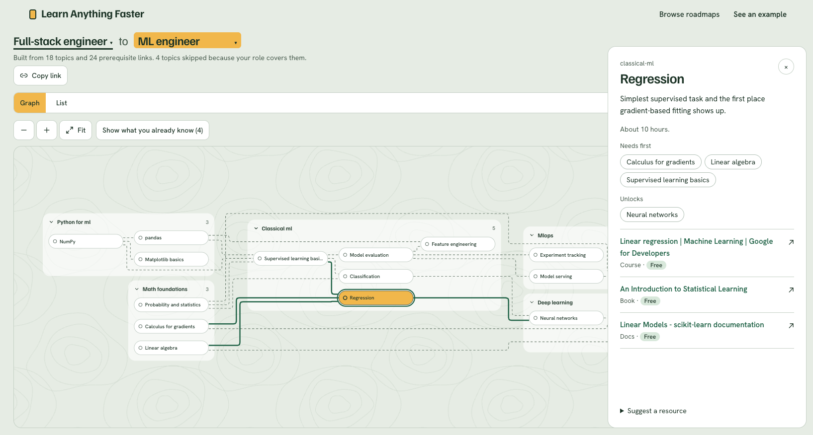

<!-- portfolio: section=ai-rag -->
# Learn Anything Faster

Pick the role you are today and the role you want to become, and get a prerequisite graph of exactly the topics in between. Topics your current role already covers are skipped, and each topic lists what you need first, what it unlocks, and free courses, books and docs to learn it from.

**Live demo:** https://learn-anything-faster.vercel.app

Keywords: `ai-rag` · LLM · learning paths · roadmaps · prerequisite graph · education
